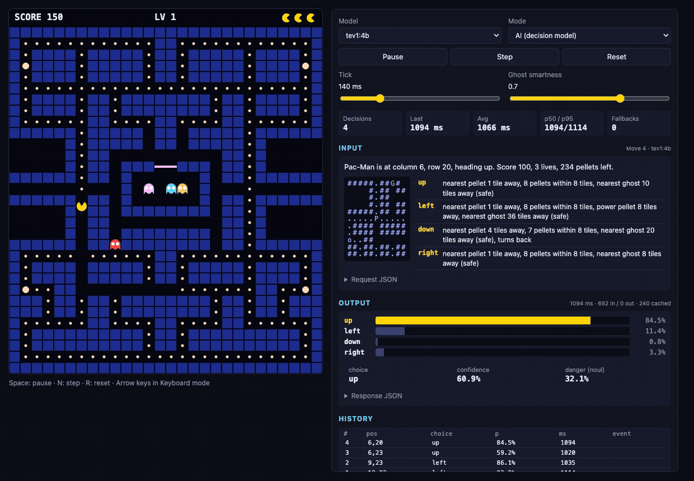

# ollama-decision-pacman

Pac-Man played by a **local, on-device decision model** through Ollama's `/v1/systemone` (Jev-style) API. The right-hand panel shows every request (`state` + typed `questions`) and response (choice, probabilities, confidence, latency) live.

로컬 Ollama 의사결정모델(`/v1/systemone`)이 팩맨을 조종하고, 우측 패널에 모델 입력(state/questions)과 출력(choice, 확률, confidence, 지연시간)을 실시간으로 보여주는 웹앱.



<sub>`tev1:4b` on Apple M4 / 16GB, played back at 2x. Each decision takes about 1 s, and the game pauses while the model thinks (lock-step). / 2배속 재생, 결정당 약 1초.</sub>

## 요구 사항

- [Ollama](https://ollama.com) 0.35.1 이상 (`/v1/systemone` 지원)
- Node.js 20 이상
- 의사결정모델 하나 이상: `tev1`, `nimble`, `clef-flash` 등

## 실행

```bash
ollama pull tev1:4b        # 기본 모델 (또는 nimble, tev1:0.8b, clef-flash)
npm install
npm run dev                # http://localhost:5173
```

Vite dev server가 `/v1`, `/api`를 `localhost:11434`로 프록시하므로 별도 백엔드가 없다. (`OLLAMA_HOST`로 변경 가능)

조작: Space 일시정지 · N 한 스텝 · R 리셋 · Mode를 Keyboard로 바꾸면 방향키로 플레이.

## 동작 방식

- **lock-step**: 팩맨이 교차로/코너/막힘/근접 유령 상황일 때만 모델에 묻고, 응답이 올 때까지 게임을 멈춘다. 그래서 지연시간이 게임 결과에 영향을 주지 않는다.
- **입력**: `state` = 상황 요약 + 11×11 ASCII 맵. `move`(choice)의 criteria에 *갈 수 있는 방향만* 넣고, 방향별로 BFS로 미리 계산한 사실(가장 가까운 펠릿, 유령 거리, 파워펠릿 등)을 설명으로 넣는다. `danger`(noul)는 표시용.
- **실패 처리**: 타임아웃(20s), 오류, 잘못된 choice가 나오면 규칙 기반 heuristic으로 대체한다 (패널에 빨간색으로 표시). 모델 목록의 `heuristic (no model)`은 비교용 베이스라인.

| 파일 | 역할 |
|---|---|
| `src/maze.ts` | 28×31 타일맵, 이동 유틸 |
| `src/game.ts` | 게임 상태, 틱, 충돌, 결정 시점 판단(`needsDecision`) |
| `src/ghosts.ts` | 유령 AI (타겟팅 + 랜덤, smartness 슬라이더) |
| `src/features.ts` | 방향별 특징 → 요청 JSON 생성, heuristic |
| `src/decision.ts` | `/v1/systemone` 클라이언트 |
| `src/render.ts`, `src/panel.ts`, `src/main.ts` | 캔버스, 우측 패널, 루프 |

## 측정 결과 (Apple M4 / 16GB, 헤드리스 80결정, 2026-10-10)

| 모델 | p50 | p95 | heuristic 일치율 | 점수(1판) | 메모리(ollama ps) |
|---|---|---|---|---|---|
| tev1:0.8b | 176 ms | 216 ms | 20% | 450 | 6.8 GB |
| **tev1:4b** (기본) | 1013 ms | 1324 ms | 81% | 3220 | 12 GB |
| nimble (9B) | 2293 ms | 3500 ms | 73% | 2210 | 17 GB (측정 중 시스템 여유 메모리 11%) |

점수는 유령이 랜덤이라 1판 기준 참고치다. tev1:0.8b는 80번 결정 동안 펠릿을 거의 먹지 못해, 사실상 판단을 못 하고 있는 것으로 보인다.

블로그의 91ms(nimble)는 M5 Max 기준이다. 16GB 머신에서는 tev1:4b가 속도와 판단력의 균형이 가장 좋다. 다른 모델(qwen2.5:14b 등)이 메모리에 같이 올라가 있지 않게 `ollama ps`/`ollama stop`으로 확인할 것.

## 참고

- 영감: [Ollama now supports Jev-style decision models](https://ollama.com/blog/ollama-now-supports-jev-style-decision-models)
- 비공식 팬 프로젝트이며, PAC-MAN 상표권자(Bandai Namco)와 관련이 없다. 미로와 그래픽은 이 저장소에서 새로 작성했다.

## License

[MIT](LICENSE)
